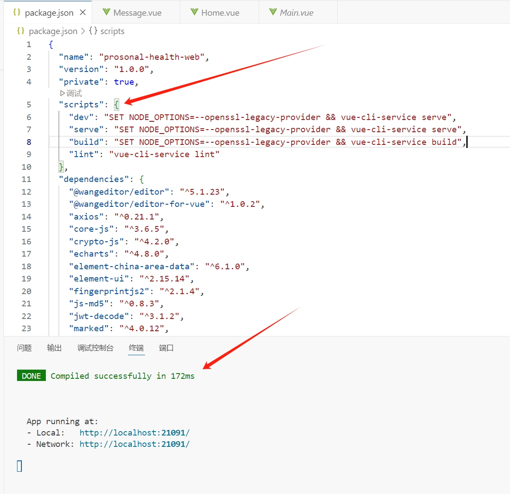

Markdown基本语法
1.标题(# + 空格 +内容)
# 一级标题
## 二级标题
### 三级标题
2.强调(自己补上****或者选中内容按下Ctrl + B)
**欢迎报考云南师范大学**
3.斜体(ctrl + I)
*欢迎报考云南师范大学*
(斜体并强调用三个星)
***欢迎***
3.删除线(用~~~~包围)
~~我是天才~~
4.引用(>)
>24岁，是学生
>>二级引用

5.无序列表(-/+ + 空格 前置)
- 一颗枣树
- 还有一颗

6.有序列表(数字+点+空格)
1. 一只羊
2. 两只羊

7.TodoList
- [ ] a
- [ ] b
- [ ] c

表格
|左对齐|居中|右对齐|
|:-----|:----:|-----:|
|a|b|c|

代码(用三个小点点包围)
```
#include<iostream>
using namespace std
int main(){
    printf("Hello world");
}
```

超链接([这是一个超链接]:连接内容)
[欢迎大家访问我的Github主页]:https://github.com/Imwdyhash

超链接

更多内容请[点击链接][教程]

[教程]:https://github.com/Imwdyhash

插入图片
1.本地存放
- 新建images文件夹
- 使用相对路径
- 